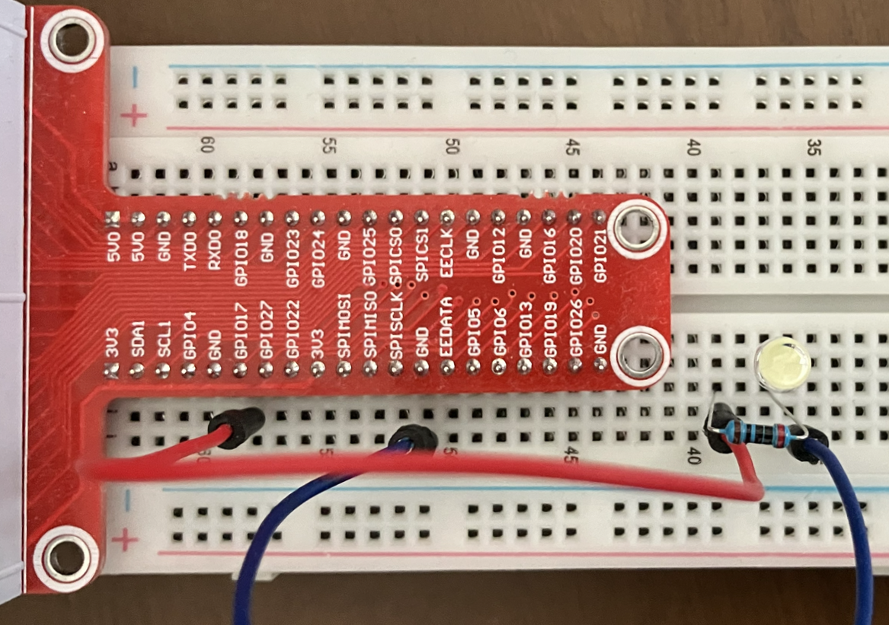
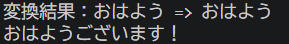
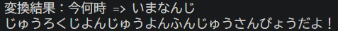
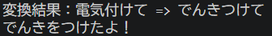
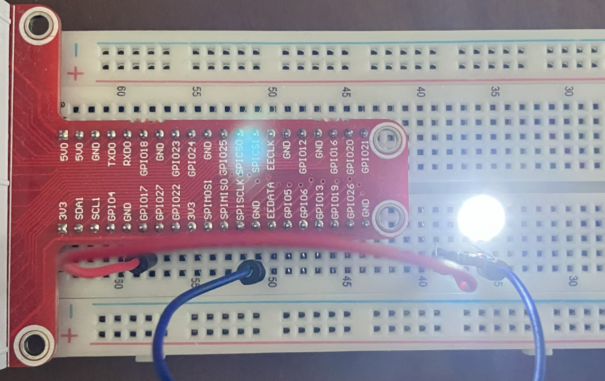
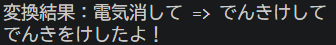

# 音声AIアシスタント

Raspberry Pi上で動作する、オフライン音声認識を利用した音声AIアシスタントです。

## 概要

マイクから入力した音声をVoskで認識し、認識結果に応じたコマンドを実行して、結果を音声で読み上げます。

コマンドと実装モジュールの対応をJSONファイルで管理し、新しいコマンドを追加しやすい構成としています。

## 主な機能

- マイクからの音声入力
- Voskによるオフライン音声認識
- 認識した文字列に応じたコマンド実行
- pyttsx3による音声読み上げ
- GPIOを利用したLEDのON/OFF
- JSONによるコマンドとGPIOの設定の管理

## システム構成

```text
マイク
  │
  ▼
音声入力
  │
  ▼
Vosk音声認識
  │
  ▼
文字列変換
  │
  ▼
CommandList
  │
  ▼
CommandFactory
  │
  ▼
各Command
  ├─ 音声応答
  └─ GPIO → LED
```

## 使用ハードウェア

- Raspberry Pi 4 Model B 4GB
- USBマイク
- スピーカー
- OSOYOO Raspberry Pi Starter Kit（LED）

## 技術スタック

- OS: Raspberry Pi OS Bookworm 64bit
- 言語: Python 3.11.2
- 音声認識: Vosk
- 音声入力: SoundDevice
- 音声出力: pyttsx3
- 入出力: RPi.GPIO
- テスト: pytest

## 依存パッケージ

### Pythonパッケージ（requirements.txt）

|パッケージ|用途|
|--|--|
|vosk|オフライン音声認識|
|sounddevice|マイク入力処理|
|pyttsx3|音声読み上げ|
|pykakasi|漢字を平仮名に変換|

### 開発・テスト用Pythonパッケージ（requirements_dev.txt）

上記に加えて、以下を使用します。

|パッケージ|用途|
|--|--|
|pytest|テストフレームワーク|

### システムパッケージ

|パッケージ|用途|
|--|--|
|RPi.GPIO|GPIO制御|
|espeak-ng|音声合成エンジン|
|libportaudio2|音声入出力|

## ディレクトリ構成

```text
voice_assistant/
├── commands/
│   ├── good_morning.py
│   ├── light_off.py
│   ├── light_on.py
│   ├── unknown.py
│   └── what_time.py
├── tests/
│   ├── test_command_list.py
│   ├── test_command_map.json
│   ├── test_light_off.py
│   ├── test_light_on.py
│   └── test_what_time.py
├── command.py
├── command_map.json
├── Gpio.py
├── gpio_config.json
├── recording_config_example.json
├── requirements.txt
└── requirements_dev.txt
```

## セットアップ

仮想環境を作成し、必要なPythonパッケージをインストールします。

```bash
sudo apt install espeak-ng libespeak-ng1 libportaudio2 portaudio19-dev -y
cd voice_assistant
python3 -m venv --system-site-packages venv
source venv/bin/activate
pip install -r requirements.txt
```

※ pytestを使用する場合は、`requirements.txt`の代わりに`requirements_dev.txt`をインストールします。

```bash
pip install -r requirements_dev.txt
```

## 音声認識モデルの準備

Voskの日本語モデルをダウンロードして展開します。

```bash
wget https://alphacephei.com/vosk/models/vosk-model-small-ja-0.22.zip
unzip vosk-model-small-ja-0.22.zip
```

`recording_config_example.json`をコピーして、実行環境用の設定ファイルを作成します。

```bash
cp recording_config_example.json recording_config.json
```

`recording_config.json`の`model_path`に、展開したVoskモデルのパスを設定してください。

`recording_config.json`は実行環境毎に異なるため、Gitの管理対象外としています。

## 配線



## テスト

```bash
python -m pytest
```

GPIOを利用するコマンドの単体テストではMockを使用し、実際のGPIOを操作せずに、想定したチャンネルに対する操作が呼び出されることを確認しています。

また、コマンド選択処理ではテスト用のGPIOクラスを使用し、実機のGPIOに依存せずコマンドの選択から実行までを確認しています。

## 実行方法

```bash
python command.py
```

## 実行結果

### 挨拶



### 時刻確認



### LED ON/OFF






### 未登録


## 設計方針

音声入力・音声認識・コマンド実行・音声読み上げの処理を分離しています。

認識した文字列と実行するコマンドの対応は`command_map.json`で管理し、`CommandList`が入力された文字列からコマンドを選択します。

`CommandFactory`は設定内容に応じて各コマンドのインスタンスを生成します。

GPIOを使用するコマンドにのみGPIOオブジェクトを渡すことで、GPIOを必要としないコマンドが不要な依存関係を持たないようにしています。

新しい機能を追加する場合は、`commands`配下へコマンドモジュールを追加し、`command_map.json`に対応する音声コマンドを設定することで追加できる構成としています。

## 課題と解決方法

### コマンド追加時の変更範囲

コマンド毎に処理をモジュールとして分割し、コマンドと実装モジュールの対応をJSONファイルへ外出ししました。

これにより、新しいコマンドを追加する際にメインの音声認識処理を変更する必要がない構成としました。

### GPIOへの不要な依存

作成当初はインターフェースを統一するため、GPIOを使用しないコマンドもGPIOクラスに依存していました。

単体テストを追加する過程でこの依存関係がテストを複雑にしていることに気付き、`CommandFactory`を導入してインスタンス生成を分離しました。

これにより、各コマンドが実際に必要とする依存関係だけを持つ構成へ変更しました。

## 今後の改善予定

- 音声読み上げの聞きやすさの改善
